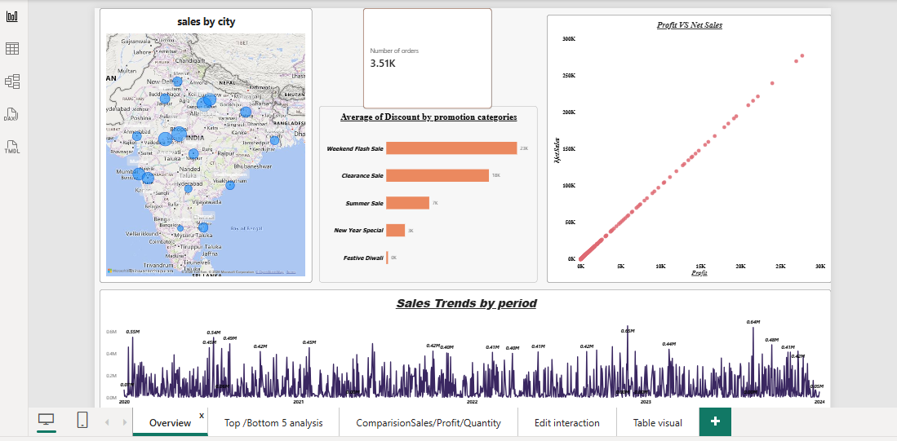
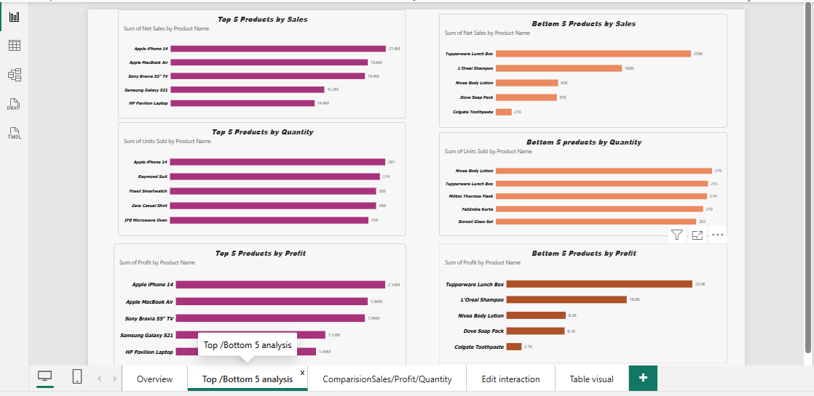
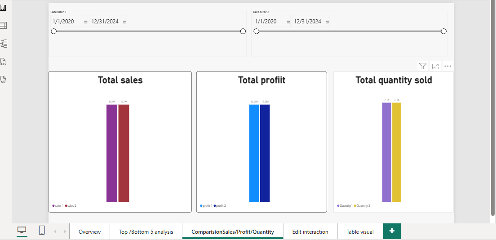
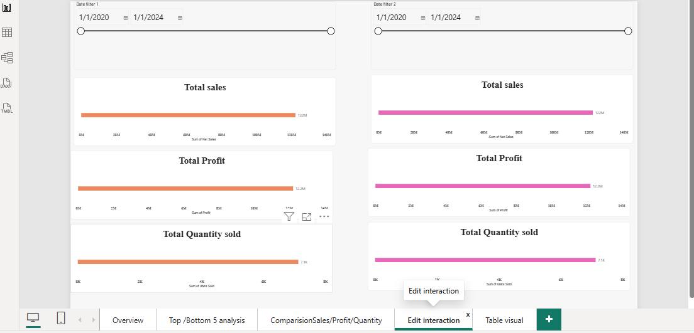
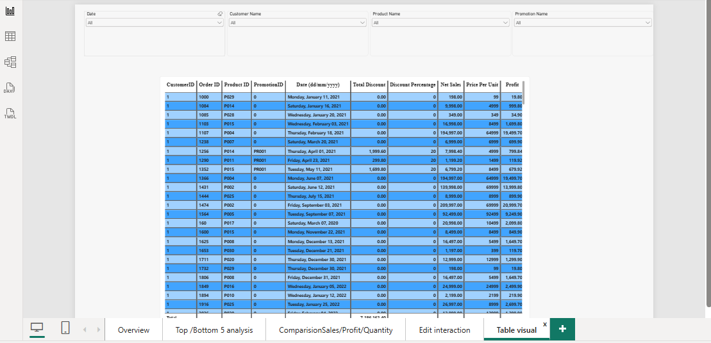

# Power BI Data Analysis Sales Project

An interactive, 5-page Power BI dashboard that analyzes sales performance
for 2020-2024, built with DAX. Every visual is connected to slicers, so you
can filter by date, customer, product, and promotion.

## Dashboard Pages

### 1. Overview
Sales by city (map), total number of orders, average discount by promotion
category, profit vs net sales, and sales trends by period.

### 2. Top / Bottom 5 Analysis
Best and worst 5 products by sales, quantity sold, and profit.

### 3. Comparison of Sales / Profit / Quantity
Compare sales, profit, and quantity sold between any two date ranges
chosen by the user.

### 4. Edit Interaction
Side-by-side date filters with controlled visual interactions.

### 5. Table Visual
Order-level details (sales, profit, discount, net sales) filterable by
date, customer, product, and promotion.

## Key Business Questions Answered
- Which products perform best and worst?
- How do sales trend over time?
- What is the relationship between sales and profit?
- How do two periods compare?
- What is the average discount per promotion category?
- Which cities generate the most sales?

## Tools & Skills
- **Power BI Desktop**: report design and interactive visuals
- **DAX**: custom measures for net sales, profit, and period comparison
- **Slicers & Edit Interactions**: date, customer, product, and promotion filters

## How to Use
Download `Powerbi Project 1.pbix` and open it in Power BI Desktop.
